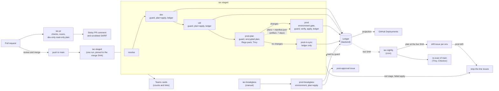
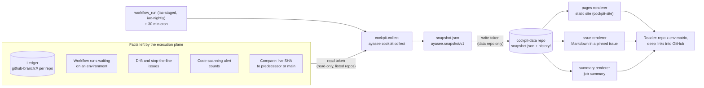

# Architecture

ayasee has two planes. The **execution plane** changes infrastructure: it plans, gates and
applies. The **observation plane** only reads: it turns what the execution plane left behind into a
snapshot of the estate. Both are built from reusable workflows, composite actions, the `ayasee`
command-line tool, a GitHub App token and git. There is no server to run.

The two planes share one rule: **stage jobs emit facts, and never talk to the cockpit**. The
execution plane writes the ledger, issues and workflow runs. The observation plane reads them.

## Design in one page

- One trunk. Environments are folders (`stages/<env>/<unit>`), not branches.
- A push to `main` starts one `iac-staged` run pinned to the merge SHA. It goes
  dev, uat, prod-plan, then a gated prod apply (see [the staged run](staged-run.md)); the pre-prod
  stages are configurable (two or three stages in all).
- Prod applies the exact approved plan: an encrypted saved plan checked against a SHA-256 manifest
  ([plan binding](plan-binding.md)). A stale or mismatched plan stops the run and asks for a re-plan
  and a new approval. It is never re-planned silently.
- "What is live" is a record in the backend, the [ledger](ledger.md). GitHub Deployments is a
  projection of it.
- A [risk gate](risk-gate.md) puts critical and high changes first and shows which principals gain
  or lose access.
- Cloud access is OIDC by default: one managed identity per environment, no stored cloud secrets.
  `identity: secrets` is an opt-in, labelled deviation for providers that cannot federate.
- The [cockpit](cockpit.md) is a read-only repository by environment matrix built from
  snapshots in git.

## Execution plane

### Components

| Component | Type | Role |
|---|---|---|
| `iac-pr` (`.github/workflows/iac-pr.yml`) | Reusable workflow | On `pull_request`: fmt and validate, Trivy and Checkov (scrubbed SARIF), a read-only plan of the changed dev units, the Rego pack on that plan, one sticky comment. Never applies. No job that evaluates PR code holds `pull-requests: write` or `security-events: write` (R39). See [pull-request checks](pr-checks.md). |
| `iac-staged` | Reusable workflow | On push to `main`: `resolve`, `dev`, `uat`, `prod-plan`, then `prod` (gated) or `prod-in-sync`, plus `prod-result` for a rejected gate. See [the staged run](staged-run.md). |
| `iac-nightly` | Reusable workflow | Per environment: drift plan at the ledger's live SHA, one issue per environment, prod drift raises stop-the-line. Re-scan of `main`. See [drift](drift.md). |
| `iac-breakglass` | Reusable workflow | The one emergency path into prod: incident reference, separate `prod-breakglass` environment and reviewers, post-approval issue. See [DORA mapping](../compliance/dora-art17.md). |
| `actions/setup` | Composite action | Installs pinned OpenTofu, Terragrunt, uv and the `ayasee` CLI, verifying SHA-256 checksums. Never uses a dependency cache (R40). It does not install Terraform. |
| `actions/guard` | Composite action | Fails closed unless the preceding stage has this SHA live and converged, and no stop-the-line issue is open. |
| `actions/plan`, `actions/apply` | Composite actions | Plan and apply per unit in dependency order. They hold the binding modes, plan encryption, the cascade check and the converge check. Logic is in `actions/plan/plan.sh`, `actions/apply/apply.sh` and `actions/lib/ayasee-lib.sh`. |
| `actions/policy` | Composite action | Runs the Databricks Rego pack with conftest on the plan JSON, inside the job that made the plan. |
| `actions/risk` | Composite action | Runs `ayasee changeset` on a directory of plan JSON files. The plan action calls the same command. |
| `actions/ledger` | Composite action | Writes the outcome of a stage to the ledger and, from `main`, mirrors it to Deployments. |
| `actions/notify` | Composite action | Teams Adaptive Cards: counts and links only. A failed post never fails a run. |
| `ayasee` CLI (`src/ayasee/`) | Python package | `binding`, `cascade`, `changed-units`, `changeset`, `config`, `drift`, `findings`, `guard`, `issue`, `approvals`, `ledger`, `notify`, `pr-comment`, `sarif-scrub` and `cockpit`. Every command fails closed. |
| `policy/databricks/` | Rego | The policy pack, see [the policy pack](../reference/policy-pack.md). |
| `rules/databricks-azure.yaml` | YAML | The risk rules, see [the risk gate](risk-gate.md). |
| `modules/github-environments`, `modules/azure-stage-identity` | OpenTofu modules | The nine environments, their reviewers and branch policies, and one managed identity with a federated credential per environment. |

Workflows reference their own actions by repository path and commit SHA. A release rewrites the
placeholder with `scripts/set-ayasee-ref.sh`, see
[where the actions come from](staged-run.md#where-the-actions-come-from).

### Environments and identities

Each environment has its own Entra managed identity and a federated credential for
`repo:<owner>/<repo>:environment:<name>` (D7). Nothing is stored as a secret. Repositories created,
renamed or transferred on or after 2026-07-15 carry GitHub's immutable subject
`repo:<org>@<id>/<repo>@<id>:environment:<env>` instead; the identity module's `subject` input is for
that case. The subject names no workflow (Entra credentials cannot match on `job_workflow_ref`), so
the boundary is the environment: its main-only branch policy and required reviewers. Full role
table: [azure-stage-identity](../../modules/azure-stage-identity/README.md#role-assignments-not-created-here).

| Environment | Used by | Branches | Reviewers | Can |
|---|---|---|---|---|
| `dev-plan` | `iac-pr` | all | none | Read dev, plan with `-lock=false` |
| `dev`, `uat` | `iac-staged` | `main` | none | Apply its own stage, its state, write the ledger |
| `prod-plan` | `iac-staged` | `main` | none | Read and plan prod (state read, lock lease), wrap and unwrap the plan key (`tofu show -json` decrypts its own plan), write the prod ledger record. Cannot apply. |
| `prod` | `iac-staged` | `main` | required, no self-review, no admin bypass | Apply prod, its state, unwrap the plan key, read and write the ledger |
| `prod-breakglass` | `iac-breakglass` | `main` | a separate required set | Its own identity: plan and apply prod in one job, wrap and unwrap, read and write the ledger |
| `drift-dev`, `drift-uat`, `drift-prod` | `iac-nightly` | `main` | none | Read, take the state lease. No apply rights. |

### Data flow of a change

1. A pull request runs `iac-pr`. The change set and risk tiers appear in a comment. Nothing is applied.
2. The merge starts one `iac-staged` run. The `dev` job runs the guard, plans and applies the units
   one at a time in dependency order, runs a converge re-plan that must be empty, and writes the
   ledger record for `dev`. `uat` repeats this.
3. `prod-plan` runs the guard, plans every prod unit, refuses a cascading change, runs the Rego pack
   and Trivy on the plan JSON inside the job, writes the manifest, and uploads only the encrypted
   plan files and `manifest.json`.
4. If nothing changes, `prod-in-sync` records prod as in sync at this SHA. Otherwise the `prod`
   environment waits for a reviewer who is not the author.
5. After approval, `prod` runs the guard again (a newer SHA that reached uat makes this run
   `superseded`), reads the approvers, verifies the artifact against the manifest, applies the exact
   plan files, converge-checks each unit and writes the ledger and the Deployments projection.
6. A failed apply opens an `ayasee:stop-the-line` issue; the guard holds later stages until it is
   closed.
7. Every night `iac-nightly` plans each environment at its live SHA and opens or updates the drift
   issue.

## Observation plane

### Components

| Component | Type | Role |
|---|---|---|
| `cockpit-collect` (`.github/workflows/cockpit-collect.yml`) | Reusable workflow | Mints two App tokens (read estate, write the data repository), runs the collector, commits `snapshot.json` and a dated history copy, and calls a renderer. Callers add the triggers. |
| `ayasee cockpit collect` (`src/ayasee/cockpit/collect.py`) | CLI | Reads ledgers and the GitHub API for every repository in `repos.yaml` and writes one `snapshot.json`. Uses ETag caching. |
| `github-branch://` ledger store | Read-only store | Reads a ledger branch through the contents API, with no clone (`src/ayasee/ledger.py`). |
| `schema/snapshot.v1.json` | JSON Schema | The public contract of the snapshot. |
| `cockpit-site/` and `actions/cockpit-site` | Vite and TypeScript site, composite action | The static matrix, detail drawer and history view. |
| `ayasee cockpit render-md`, `history-index` | CLI | The Markdown renderer and the history index the site reads. |

### Data flow

1. After each `iac-staged` or `iac-nightly` run, `workflow_run` starts the wrapper workflow; a
   30-minute cron covers repositories whose events the wrapper cannot see.
2. The collector computes, per repository and environment, the live SHA, pending commits, gate state,
   drift, and health, plus findings counts per repository. See [the cockpit](cockpit.md).
3. The write token commits `snapshot.json` and `history/YYYY/MM/DD/HHMM.json` to the data repository,
   but only when something changed besides `generated_at`.
4. A renderer presents the snapshot. Writes such as approve or re-drive stay in GitHub's own UI; the
   cockpit links to them.

## Trust boundaries

- **PR code is untrusted.** `iac-pr` plans it with a read-only identity and never applies. See
  [SECURITY.md](../../SECURITY.md) for the full threat model.
- **No values leave a job.** Plan JSON and plan files stay in the job that made them; only encrypted
  plan files and the manifest are uploaded. The change set, comments, Teams cards, SARIF and the
  snapshot carry counts, addresses and links only (D8, D10).
- **Engine output never reaches the job log.** It goes to `$RUNNER_TEMP/ayasee/<env>/logs`.
- **Scoped tokens.** The collector's read token is limited to the repositories it lists; its write
  token to the data repository (R62, [cockpit setup](../cockpit/setup.md#why-two-tokens)).

## Known limitations

- **GHES-specific behaviour is unverified.** The workflows target github.com first (D11).
  `ayasee features --json` detects the platform from `GET /meta` (`installed_version` means GHES)
  and reports the OIDC issuer (`https://HOST/_services/token` on GHES), `queue_max`,
  `deployment_false`, `lockfiles` and `private_pages`. On GHES every flag is false unless a verified
  entry exists in a version table that is empty today. `iac-staged` exposes the result as the
  `resolve` output `features` (a failing detection only warns and yields `{}`), but no workflow consumes it yet. The setup and policy actions accept
  `tool-mirror` so a runner without github.com access can download its tools (checksums still
  apply). The platform comes from the API host (R67): `api.github.com` is github.com,
  `api..ghe.com` is GitHub Enterprise Cloud with data residency (`ghec-dr`, issuer
  `https://token.actions..ghe.com`, every flag false until verified), a host whose `/meta` has
  `installed_version` is GHES, and any other host makes detection fail ("unknown platform"). Nothing has run on a real GHES: see the unfilled version matrix in
  [`e2e/ghes/README.md`](../../e2e/ghes/README.md). Reusable-workflow context properties, environment
  deployment records for PR plans, Pages visibility and the immutable OIDC `sub` format remain
  untested there.
- **The e2e sandbox has not been run.** The scenarios in [`e2e/`](../../e2e/README.md) and the
  `e2e.yml` workflow are implemented and unit-tested against fakes. They have never run against a real
  sandbox repository, so the first real run may need fixes.
- **`gate: risky` is not supported (R35).** Prod always asks for approval. `iac-staged` refuses a
  configuration with `gate: risky` ("gate: risky is not supported yet").
- **Other settings not supported yet are refused too (R73).** `engine: terraform`,
  `terragrunt: false`, a non-empty `extra_rules` and `notify.teams: false` fail the first job of
  every reusable workflow with "<key>: not supported yet" (`ayasee config check-supported`).
- **Break-glass has no unit scope (R71).** It plans and applies the whole prod tree; unchanged units
  are no-ops, so the ledger record stays truthful.
- **The cockpit reads only `github-branch://` ledgers.** `cockpit-collect` has no cloud login.
- **Cascades need sequential merges (R52).** When a unit and a unit that reads its outputs both
  change, `prod-plan` refuses the plan ("cascading change: land the upstream unit first"). Land the
  upstream unit in its own merge. This includes first-time adoption of dependent units.
- **Dependents of changed units are not planned in PRs.** `iac-pr` plans the changed dev units only;
  a unit that reads a changed unit's outputs is planned only when a change outside `stages/dev/`
  (a module, `root.hcl`, `.ayasee.yaml`) makes the PR plan every dev unit.
- **Plain Terraform is not wired into `iac-staged`.** The replan fallback (D1(b)) exists in the
  actions and the CLI, but `iac-staged` always runs prod in `encrypted_plan` mode, which needs
  OpenTofu, and the setup action installs only OpenTofu. See [plan binding](plan-binding.md#the-replan-fallback).
- **Azure first.** The default, and the only profile designed end to end, is Entra identities,
  Azure Key Vault plan encryption and the `azure-blob://` ledger store. A provider-neutral profile
  exists but has not run on GitHub: `identity: secrets` skips the Azure login and passes
  provider tokens from environment secrets (labelled as a deviation in the run summary, not yet in
  the cockpit),
  `plan_encryption.key_provider: pbkdf2` encrypts the prod plan with a passphrase held as an
  environment secret, the quickstart has a [reference S3 `root.hcl`](../guides/quickstart.md#without-azure),
  and `github-branch://` is the ledger store that needs no cloud. There is no `s3://` ledger store,
  and the `openbao`, `aws_kms` and `gcp_kms` key providers are not wired.
- **Two or three stages only.** `iac-staged` runs `[<pre-prod>, prod]` or
  `[<first>, <pre-prod>, prod]`; longer lists are refused in `resolve`. No two-stage run has been
  executed on GitHub yet.
- **`extra_rules` is not forwarded by the workflows.** Adopter risk rule files work in the `risk`
  action and the CLI (`--rules`), but `iac-staged` does not pass the `extra_rules` key through yet.
- **Not a write UI.** The cockpit is read-only. It never approves, syncs or re-drives.

## Deliberate non-blocking paths

A few steps exit 0, or let the run continue, on purpose. Each one only reports; none of them can
let a change reach an environment that a failing check would have stopped.

| Path | What happens | Why it does not block |
|---|---|---|
| Notifications (R24) | `ayasee notify` exits 0 when the webhook is unset or the post fails (exit 2 only on bad arguments). | A Teams outage must not fail a deployment that already happened, or stop one that is safe. The ledger, the issues and the job summary are the record. |
| Platform features (R67) | The `features` step of `resolve` is `continue-on-error` and falls back to `{}` with a warning. | The output is informational; no workflow consumes it yet. |
| Nightly re-scan (T14) | Trivy runs with `exit-code: 0` and Checkov with `--soft-fail` in `rescan`. | Findings on `main` become code-scanning alerts; new high or critical ones are counted (`ayasee findings new`, which does fail on error) and notified. The prod plan scan and the PR checks still fail on findings. |
| Drift while an apply failure is open (R41) | A drift job skips its environment with a notice when an open `ayasee:apply-failed` issue exists for it. | The state may be half-applied; the open issue already holds the stage (stop-the-line), and a drift issue would duplicate it. |
| Break-glass without a prod ledger record | The rollback check is skipped with a notice ("first deploy, no rollback check"). | There is no live commit to compare with. The ancestry check (the sha is on `main`), the reviewers and the policy pack still apply. |

